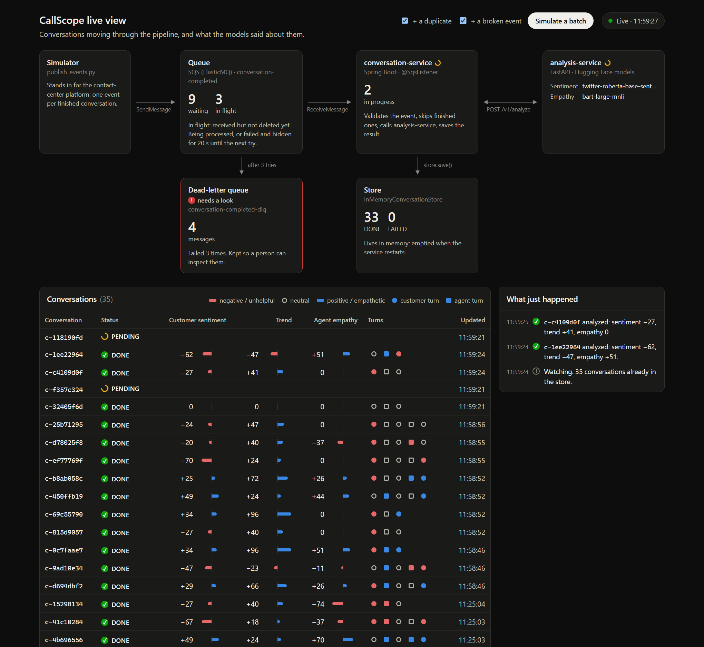
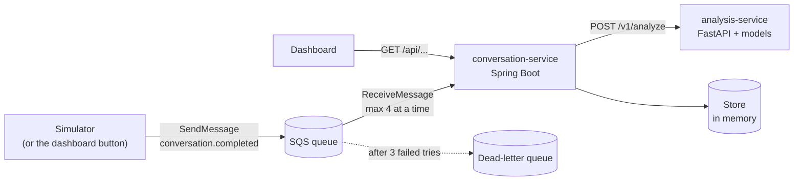

# CallScope

[](https://github.com/nirkem/callscope/actions/workflows/ci.yml)

Scores contact-center conversations after they end: **customer sentiment**, how it **changed during the
call**, and **agent empathy**. Two services talk through a queue, the way conversation analytics runs
at scale: Spring Boot owns the workflow, FastAPI runs the models.

Everything runs locally and for free: real Hugging Face models on the CPU, and an SQS-compatible queue
(ElasticMQ) instead of AWS.



## How it works



1. When a conversation ends, an event with its turns goes to the queue
   ([example](contracts/examples/conversation-completed.json)).
2. **conversation-service** receives it, validates it, skips it if it was already analyzed, marks it
   PENDING, and calls analysis-service.
3. **analysis-service** labels each turn: sentiment for customer turns, empathy for agent turns. It
   then turns the labels into three scores from −100 to +100.
4. conversation-service saves the result as DONE and deletes the message from the queue. If anything
   fails, it saves FAILED with the reason and leaves the message in the queue. SQS hands it out again
   20 s later, and after 3 failed tries moves it to the dead-letter queue. Nothing is lost.

## Run it

You need [Docker Desktop](https://www.docker.com/products/docker-desktop/). From the `infra` folder:

```bash
docker compose up --build
```

The first start downloads about 2 GB of models and takes around 2.5 minutes. Later starts take about
20 seconds, because the models are kept in a Docker volume.

Then open the dashboard at **http://localhost:8080/** and click **Simulate a batch**.

| | |
|---|---|
| Dashboard | http://localhost:8080/ |
| All results (JSON) | http://localhost:8080/api/conversations |
| One result | http://localhost:8080/api/conversations/{id} |
| analysis-service API docs | http://localhost:8000/docs |

Stop everything with `docker compose down`; the downloaded models are kept.

You can also send events from the command line instead of the button. From the repository root:

```bash
pip install -r simulator/requirements.txt
python simulator/publish_events.py --count 10 --duplicate --invalid
```

`--duplicate` sends the last event twice, to show duplicates are skipped. `--invalid` adds an event
with no turns, which ends up in the dead-letter queue.

## The dashboard

One page, served by conversation-service, updated twice a second:

- **The pipeline** with live counts: messages waiting and in flight, the dead-letter queue, and the
  store's DONE / FAILED totals. Dots travel along the arrows as messages move.
- **Every conversation** with its three scores and one mark per turn. Click a row to see each turn's
  label and how sure the model was.
- **What just happened**: a feed of arrivals, results, failures, retries and dead letters.

## The scores

Each turn's label counts as +1, 0 or −1, times the model's confidence. Then:

| Score | How it's calculated |
|---|---|
| Customer sentiment | Average over the customer's turns. The last 15% count double: how a call ends matters most. |
| Sentiment trend | The second half of the customer's turns minus the first half. Positive: the customer ended happier. |
| Agent empathy | Average over the agent's turns. |

A score is empty when there's nothing to measure, for example no agent turns.

## The models

| Task | Model | Why |
|---|---|---|
| Customer sentiment | `cardiffnlp/twitter-roberta-base-sentiment-latest` | Trained on short, informal text, close to chat and speech-to-text. |
| Agent empathy | `facebook/bart-large-mnli`, zero-shot | No empathy model exists off the shelf. The sentiment model calls every apology NEGATIVE, which would score the most caring agents worst. |

Where they fail, with real outputs: [docs/model-notes.md](docs/model-notes.md). In short: sentiment got
9 of 11 hard sentences right, and empathy 10 of 10. Low-confidence answers are unstable (a full stop
flipped one label), and frustration without negative words ("It's been two weeks!") is missed.

## Tests

CI runs both on every push, without Docker or models: each service's tests replace the services around
it with fakes.

```bash
# analysis-service: keyword classifiers instead of the models
cd analysis-service
pip install -e ".[dev]"
pytest
mypy app tests

# conversation-service: no queue needed
cd ../conversation-service
./mvnw test
```

Install `.[ml]` as well to also run the two tests that load the real models.

## Measured

On a laptop, CPU only:

| | |
|---|---|
| Analysis of a 3-turn conversation (warm) | ~0.5 s |
| Burst of 20 conversations, 4 at a time | 2.1 s each (median), 13.5 s in total, no failures |
| Same burst, 10 at a time | 4.4 s each (median), 10.7 s in total |
| Broken event to dead-letter queue | ~61 s (3 tries, 20 s apart) |
| analysis-service stopped, then restarted | The conversation recovered by itself on the next try |

Why 4 at a time: the models share the CPU, so taking more messages at once makes each one slower. After
a night idle, 10 at once pushed one call past the 10 s timeout. The read timeout also has to stay below
the queue's 20 s visibility timeout, or SQS hands the message to a second worker while the first one is
still waiting.

## Design decisions

- **A queue between the platform and the analysis.** Conversations arrive in bursts. The queue absorbs
  them, retries failures, and lets each side scale on its own.
- **Spring Boot for the workflow, Python for the models.** The ML ecosystem is in Python; the
  long-running, stateful workflow fits a JVM service.
- **One contract, checked on both sides.** The Pydantic models in `analysis-service/app/schemas.py` are
  the source of truth. Both services test themselves against the same example messages in
  `contracts/examples/`.
- **Models behind an interface.** `TextClassifier` has a real and a fake implementation.
  `CALLSCOPE_MODELS=fake` (the default) starts instantly for tests and CI; Docker sets `real`.
- **Idempotent processing.** SQS can deliver a message more than once, so a conversation already DONE is
  skipped.
- **ElasticMQ instead of LocalStack.** It speaks the same SQS API, so only the endpoint URL changes for
  real AWS, and it's free without an account.

## Known limitations

- **A duplicate that arrives at the same moment is analyzed twice.** Both copies check the store before
  either one saves, so both run. A late duplicate is skipped correctly. The fix is an atomic claim, for
  example a DynamoDB conditional write ("save PENDING only if no record exists").
- **The store is in memory**, so it's emptied on restart.
- **Only labels and scores are stored**, not the conversation text.
- **The models read one turn at a time**, without the turns around it.

## Designed, not built

Left out to keep the project small enough to finish and explain:

- **DynamoDB** behind the existing `ConversationStore` interface, with the conditional write above.
- **Deployment on AWS:** both services as containers (ECS), real SQS, and consumers that scale with the
  queue's depth.
- **Integration tests** against a real queue with Testcontainers.
- **Evaluation forms with an LLM** (`/v1/evaluate`): score a conversation against a supervisor's
  questions. Example form and answer: [contracts/examples/](contracts/examples/).
- **Load testing** at production volume.

## Repository layout

```
analysis-service/       FastAPI, the models, scoring, and their tests
conversation-service/   Spring Boot: SQS listener, processor, store, HTTP API, the dashboard
contracts/examples/     Example messages, checked by both services' tests
docs/model-notes.md     Where the models succeed and fail
infra/                  docker-compose.yml and the queue's configuration
simulator/              Sends test events to the queue
```
